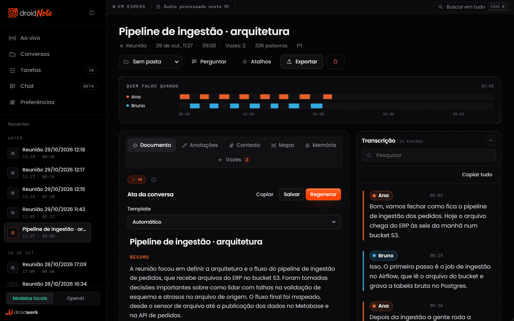
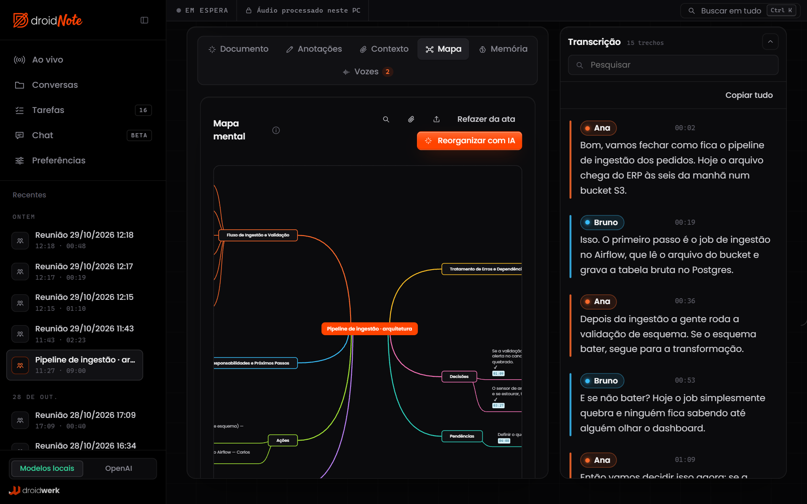
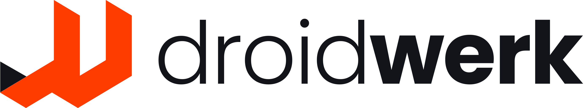

<p align="center">
  <picture>
    <source media="(prefers-color-scheme: dark)" srcset="desktop/src/assets/logo-droidnote.png">
    
  </picture>
</p>

<p align="center">
  <strong>The local-first meeting and lecture notetaker.</strong><br>
  Live transcript with speaker identification, minutes with evidence, tasks, mind maps and a memory across meetings — all on your PC, no bot in the call.
</p>

<p align="center">
  <a href="https://github.com/droidwerk/droidNote/releases/latest/download/DroidNote-Setup.exe"></a>
  &nbsp;
  <a href="https://github.com/droidwerk/droidNote/releases/latest"></a>
</p>

<p align="center">
  <a href="https://github.com/droidwerk/droidNote/actions/workflows/release.yml"></a>
  <a href="https://github.com/droidwerk/droidNote/releases"></a>
  <a href="CHANGELOG.md"></a>
  <a href="LICENSE"></a>
  
  
</p>

<p align="center">
  <a href="README.pt-BR.md">🇧🇷 Português</a> · <a href="docs/architecture.md">Architecture</a> · <a href="docs/development.md">Development</a> · <a href="docs/ROADMAP.md">Roadmap</a> · <a href="CHANGELOG.md">Changelog</a>
</p>

---

DroidNote records the microphone and, if you want, the audio of other apps (Meet, Teams, Zoom, a video, a lecture) and turns it into a transcript, minutes, tasks and a mind map. It does not join the call as a bot and does not need an account. Everything can run on your own computer; the OpenAI API is an opt-in choice for people who want more accuracy.

The interface is available in Portuguese, English, Spanish, Italian, German, French and Russian, and the transcription language is independent of the interface language.

<p align="center">
  
</p>

## What you can do

| | |
| --- | --- |
| 🎙️ **Capture** | Microphone and system audio on this PC. Echo filter so a call without headphones is not transcribed twice. No bot invited to the meeting. |
| 🗣️ **Who spoke** | Voices are separated by sound, in real time. Name a voice once and DroidNote recognises it in the next recordings — the "speaking now" badge shows the name before the transcript arrives. |
| 📝 **Transcript** | Local Whisper (GPU or CPU) or the OpenAI API. Every line carries its time; search everything that was ever said with `Ctrl+K`. |
| 📄 **Minutes** | Topics, decisions, actions and open items, each ending with the moment in the transcript that supports it. Click the timestamp to hear it. Templates per meeting type. |
| ✅ **Tasks** | Actions from the minutes become tasks with owner and due date, in one list across all meetings. |
| 🧠 **Mind map** | Built from the minutes at no cost: topics, decisions, actions, open items and material, each leaf linked to the speech. Editable; "Reorganize with AI" regroups branches without losing a leaf. |
| 🔁 **Memory across meetings** | Meetings with the same title or the same people form a series. Before the meeting: what was decided and what stayed open. After: what was resolved, what changed, what is new. |
| 📎 **Context** | Drop the agenda, slides or a contract into the meeting. The minutes and the chat use the right names and terms from it. |
| 💬 **Chat** | Ask about one meeting or all of them, with sources you can open. Attach documents (PDF, Word, Excel). |
| 🗓️ **Calendar brief** | Paste the secret ICS address of your calendar (Google, Outlook, iCloud) and the next meeting shows up with what is still pending. |
| 📤 **Export** | Markdown, PDF and Word with the DroidNote look; the mind map as PNG. |

<p align="center">
  
</p>

## Where your audio is processed

You choose on first run and can change it in Preferences.

| | Local models | OpenAI API |
| --- | --- | --- |
| Audio and text | Stay on this computer | Audio windows and minutes text are sent to OpenAI |
| Transcription | Whisper `large-v3-turbo` on an NVIDIA GPU (6 GB+), `small` on CPU | `gpt-transcribe` |
| Minutes, chat, mind map | Gemma 4 or Qwen 3.6 through [Ollama](https://ollama.com), sized to your RAM and graphics card | `gpt-6-luna` (default), `gpt-5.6-luna`, `gpt-5.6-terra` |
| Cost | Free; a one-time download of a few GB | Your own key, paid per use — a one-hour meeting costs cents |
| Accuracy | Good; names and overlapping speech are harder | Best |

The setup wizard reads your RAM, graphics card and free disk and explains which models it picked and why. The WAV recording is optional and can be turned off. An API key, if you use one, is stored only on this machine.

Record other people only with the appropriate consent. DroidNote does not notify the other participants of a call; a ready-to-paste notice is one click away in the live screen.

## Get started

1. Download [DroidNote-Setup.exe](https://github.com/droidwerk/droidNote/releases/latest/download/DroidNote-Setup.exe).
2. Run the installer **without administrator rights**; it installs for the current user only.
3. On first run, pick the interface language, choose local models or the OpenAI API, and accept the terms. The wizard shows what will be downloaded and how big it is.
4. Open **Live**, choose *Dictation*, *Lecture* or *Meeting*, and press record.

Windows SmartScreen may warn on the first run while the installer carries no Authenticode signature. Use **More info → Run anyway** if you downloaded it from this repository.

**Updating.** Install the new version over the current one; notes, recordings and models are kept. The app shows a notice when a new release is out; updates are never automatic.

**Where things live.** User data in `%APPDATA%\DroidNote`, the program in `%LOCALAPPDATA%\DroidNote`, local Whisper models in the data folder, Ollama models in Ollama's own folder.

### Or let your AI agent install it

Paste the line for the agent you use; it runs the official script, checks the installer's checksum and opens the app. Details and what the script does: [Install with your AI agent](docs/INSTALL_WITH_AI.md).

| Agent | Command |
| --- | --- |
| Claude Code | `claude "Install DroidNote on this Windows PC by following https://github.com/droidwerk/droidNote/blob/main/docs/INSTALL_WITH_AI.md and tell me when the app is open."` |
| Codex CLI | `codex "Install DroidNote on this Windows PC by following https://github.com/droidwerk/droidNote/blob/main/docs/INSTALL_WITH_AI.md and tell me when the app is open."` |
| Gemini CLI | `gemini -i "Install DroidNote on this Windows PC by following https://github.com/droidwerk/droidNote/blob/main/docs/INSTALL_WITH_AI.md and tell me when the app is open."` |
| Copilot CLI | `copilot -p "Install DroidNote on this Windows PC by following https://github.com/droidwerk/droidNote/blob/main/docs/INSTALL_WITH_AI.md and tell me when the app is open."` |
| Cursor CLI | `cursor-agent "Install DroidNote on this Windows PC by following https://github.com/droidwerk/droidNote/blob/main/docs/INSTALL_WITH_AI.md and tell me when the app is open."` |
| No agent | `irm https://github.com/droidwerk/droidNote/releases/latest/download/install.ps1 \| iex` |

## Platforms

| Platform | Status |
| --- | --- |
| Windows 10/11 x64 | ✅ Installer on every release |
| macOS | 🗺️ On the [roadmap](docs/ROADMAP.md) — the audio capture layer is Windows-only today |
| Linux | 🗺️ On the roadmap |

Requirements: 64-bit Windows, a microphone (and, for system audio, a loopback device), disk space for local models if you choose that path. An NVIDIA GPU with 6 GB or more makes local transcription much faster, but it is not required.

## How it is built

A [Tauri 2](https://tauri.app) desktop app with a React + TypeScript interface, and a Python sidecar (FastAPI) that does the heavy lifting: audio capture with WASAPI, [faster-whisper](https://github.com/SYSTRAN/faster-whisper) for transcription, a [WeSpeaker](https://github.com/wenet-e2e/wespeaker) ONNX voice embedder for speaker identification, Ollama or the OpenAI API for language models, and SQLite for storage. The mind map editor is [mind-elixir](https://github.com/SSShooter/mind-elixir-core).

- [Architecture](docs/architecture.md) — processes, layers, data model, capture and voice engine
- [Development](docs/development.md) — running in dev mode, tests, building the installer
- [Releasing](docs/RELEASING.md) — versioning, the release workflow and the changelog
- [Roadmap](docs/ROADMAP.md) — what comes next

## Versioning

DroidNote follows [Semantic Versioning](https://semver.org): `MAJOR.MINOR.PATCH`. Every push to `main` that passes the tests ships a new patch release; `[release minor]` or `[release major]` in the commit message bumps the other parts. Each release is a Git tag (`v2.2.5`), a GitHub release with the installers, and a dated section in the [changelog](CHANGELOG.md).

## Contributing, support and security

- Bugs and ideas: [open an issue](https://github.com/droidwerk/droidNote/issues) using the templates.
- Code: written by DroidWerk and invited collaborators. Unsolicited pull requests are closed; describe your fix in an issue instead. See [CONTRIBUTING.md](.github/CONTRIBUTING.md).
- Help with setup or models: [SUPPORT.md](.github/SUPPORT.md).
- Vulnerabilities: **never in a public issue** — see [SECURITY.md](.github/SECURITY.md).

## License

DroidNote is free software under the [GNU Affero General Public License v3.0](LICENSE). You can use it, study it, change it and share it; if you distribute a modified version or offer it over a network, you must make your source available under the same terms.

```
DroidNote — meeting transcription, minutes and memory, on your own PC.
Copyright (C) 2026 DroidWerk

This program is free software: you can redistribute it and/or modify it under the
terms of the GNU Affero General Public License as published by the Free Software
Foundation, either version 3 of the License, or (at your option) any later version.

This program is distributed in the hope that it will be useful, but WITHOUT ANY
WARRANTY; without even the implied warranty of MERCHANTABILITY or FITNESS FOR A
PARTICULAR PURPOSE. See the GNU Affero General Public License for more details.
```

- The **DroidNote and DroidWerk names and logos are trademarks** and are not covered by the AGPL: see [TRADEMARK.md](TRADEMARK.md).
- Third-party components and models keep their own licences, listed in [THIRD_PARTY_NOTICES.md](THIRD_PARTY_NOTICES.md). Models are downloaded from their official sources; the wizard shows what will be fetched before installing.

---

<p align="center">
  <a href="https://www.droidwerk.com.br/">
    <picture>
      <source media="(prefers-color-scheme: dark)" srcset="desktop/src/assets/logo-droidwerk.png">
      
    </picture>
  </a><br>
  <sub>A <a href="https://www.droidwerk.com.br/">DroidWerk</a> product</sub>
</p>
