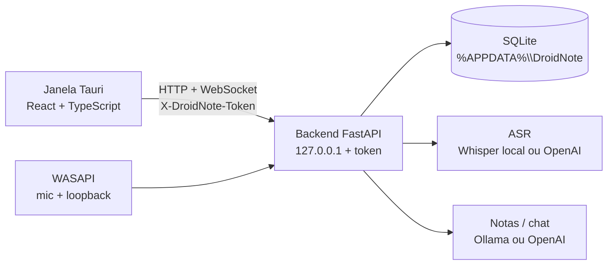

# Arquitetura

DroidNote é um app desktop Windows: uma janela Tauri (React) fala com um backend FastAPI que corre **neste PC**, em `127.0.0.1`. Não há servidor na nuvem DroidWerk. Conta e bot em Meet/Teams/Zoom não existem.

O processamento de áudio e notas é um **porto** (`AsrPort`, `LlmPort`). A implementação muda conforme o utilizador escolhe modelos locais ou API OpenAI. O resto da aplicação (sessões, captura, UI) não sabe qual motor está por baixo.

## Vista geral



Na instalação, o programa vive em `%LOCALAPPDATA%\DroidNote`. Dados do utilizador (base, modelos, gravações, `runtime.json`) ficam em `%APPDATA%\DroidNote`. Em desenvolvimento o perfil é `%APPDATA%\DroidNote-dev`, para não misturar com o app instalado.

## Processos

| Processo | Papel |
| --- | --- |
| `droidnote.exe` | Shell Tauri: janela, tray, instância única, arranque do sidecar |
| `droidnote-backend.exe` | FastAPI empacotado com PyInstaller (`resources/droidnote-backend/`) |
| Ollama (opcional) | Motor de notas local, processo à parte, em `127.0.0.1:11434` |

O shell espera uma linha `DROIDNOTE_READY {host, port, token}` no stdout do sidecar (timeout 45 s). A UI chama `invoke("get_backend")` e passa URL + token ao cliente HTTP. Sem essa handshake a janela não fala com a API.

O instalador NSIS mata `droidnote.exe` **e** `droidnote-backend.exe` antes de gravar ficheiros. O sidecar PyInstaller bloqueia `.pyd` se ficar órfão.

Atualização: a UI consulta `https://api.github.com/repos/droidwerk/droidNote/releases/latest` e mostra um diálogo. Não há `tauri-plugin-updater`. Motivo: o Setup ainda não leva Authenticode EV.

## Camadas do backend

Hexagonal, dependências para dentro.

```
backend/app/
  domain/           modelos e Protocol (AudioCapturePort, AsrPort, LlmPort, SessionRepository)
  application/      casos de uso: captura, sessões, resumo, chat, setup, falantes
  infrastructure/   WASAPI, Whisper, OpenAI, Ollama, SQLite
  api/v1/           HTTP / WebSocket
  core/             config, token, DPAPI, i18n, hardware
```

`create_app` monta o `AppContainer` no lifespan: store, ASR, LLM, `CaptureService`, `ChatService`, etc. OpenAPI/Swagger estão **desligados** (`docs_url=None`): a API não é um produto público.

### Rotas

| Superfície | Função |
| --- | --- |
| `GET /health` | Liveness sem token (usado pelo `dev.ps1`) |
| `/capture`, `/sessions`, `/setup`, `/people`, `/tags`, `/chat` | REST autenticado |
| `WS /ws/transcript` | Segmentos e estado de captura em tempo real |

Header: `X-DroidNote-Token`. No WebSocket o mesmo token vai em query ou header. O token é gerado no arranque (`secrets.token_urlsafe`) e não sai da máquina.

CORS só aceita origens da UI local (`localhost:1420`, `tauri.localhost`, …).

## Dados

SQLite em `%APPDATA%\DroidNote\droidnote.db` (`aiosqlite`).

Tabelas: `sessions`, `segments`, `people`, `session_participants`, `summaries`, `settings`, `tags`, `session_tags`, `chats`, `chat_messages`.

Gravações WAV (se ligadas): `%APPDATA%\DroidNote\recordings\<session_id>.wav`. Modelos Whisper: `...\models\`.

A chave `asr_api_key` na tabela `settings` é protegida com DPAPI do Windows (`dpapi:v1:`). Texto antigo é lido e migrado.

## Captura e transcrição

1. WASAPI captura mic e, se pedido, loopback do sistema. Cada canal passa por um `StreamResampler` (FIR passa-baixa + fase contínua entre blocos) até 16 kHz. O loopback entra numa fila (`_LoopbackFifo`, latência de 60–300 ms com correção de deriva de relógio), não mais em "último bloco".
2. Sem fone, o microfone escuta o alto-falante. O `EchoGate` silencia, só para a transcrição, os quadros de 20 ms do microfone que são eco do áudio do sistema. O WAV continua com tudo.
3. O Silero VAD (já incluso no faster-whisper) decide fala por quadro de 32 ms em cada canal (`StreamingVad`). Sem ele, volta o portão por energia.
4. `CaptureService` parte cada canal em janelas (até ~20 s, corte em pausa de 400 ms) e manda ao `AsrRouter.transcribe_words`: Faster-Whisper devolve palavras com início e fim; o filtro de alucinação vale por frase.
5. O motor de voz (abaixo) diz quem falou cada palavra e devolve turnos. Cada turno vira um segmento com `speaker_cluster` ("v1", "v2"…), confiança e, se reconhecida, a pessoa.
6. Segmentos vão para SQLite e para o `EventBus`; o WebSocket empurra à UI. A cada ~80 ms sai um quadro de monitor com nível e fala por canal, eco filtrado e a voz que está falando agora.

Idioma da **captura** (`language`, inclui `auto`) é independente do idioma da **interface** (`ui_language`). O instalador pode semear a UI via `%APPDATA%\DroidNote\install-lang.txt`.

## Motor de voz (quem falou)

Tudo roda neste PC, na CPU. Nada de áudio sai da máquina por causa do motor de voz, mesmo com a transcrição pela OpenAI.

| Peça | Arquivo | Papel |
| --- | --- | --- |
| Feature | `infrastructure/voice/fbank.py` | Log-mel 80 bandas idêntico ao `kaldi.fbank`, em numpy (sem torch) |
| Impressão vocal | `infrastructure/voice/embedder.py` | WeSpeaker ResNet34-LM em ONNX (26 MB, SHA-256 conferido), ~10 ms por segundo de fala |
| Diarização da janela | `infrastructure/voice/diarize.py` | Embeddings em sub-janelas de 1,5 s (passo 0,75 s), agrupamento local, voz por palavra, turnos |
| Vozes da sessão | `infrastructure/voice/tracker.py` | Rastreador incremental + clusterização espectral (NME-SC, eigengap) + memória de vozes |
| Orquestração | `application/voices.py` | Vozes ao vivo, reagrupamento, nomes, impressões vocais, sonda "falando agora" |

Fluxo:

- **Ao vivo**: cada janela é diarizada contra as vozes já vistas na sessão. Trecho curto demais nunca funda voz nova; herda do vizinho.
- **Reagrupamento**: a cada ~40 s de fala nova (ou 15 s depois de surgir uma voz), a sessão inteira é reagrupada por clusterização espectral sobre as sub-janelas. Isso conserta a fragmentação típica do modo incremental em áudio ruidoso. Os rótulos ficam estáveis (cada grupo herda a voz antiga com mais tempo em comum) e numerados pela ordem em que apareceram. A UI recebe `{"type":"voices"}` e recarrega.
- **Fim da gravação**: reagrupamento final; em ditado ou chamada, a voz dominante do microfone vira a de quem grava (`self_person_id`) e alimenta a impressão vocal dela.
- **Nomear uma voz** (`PUT /sessions/{id}/voices/{cluster}` ou rotular um trecho com "aplicar à voz inteira") dá o nome a todos os trechos daquela voz e atualiza a impressão vocal da pessoa (`voiceprints`). Na gravação seguinte ela é reconhecida sozinha.
- **Rótulo manual de um trecho só** trava o trecho (`speaker_locked`): o reagrupamento não mexe nele.
- **Sessões antigas** com WAV: "Reanalisar vozes" tira as impressões do arquivo gravado.
- **Falando agora**: a cada ~0,6 s, o último 1,5 s do canal com fala é comparado às vozes da sessão (sem criar voz nova). Sai no quadro de monitor antes de a transcrição chegar.

Limiares calibrados com áudio real (referência com gabarito do pyannote, entrevistas e reuniões em português): mesma pessoa fica em ~0,65 de cosseno entre sub-janelas e pessoas diferentes abaixo de ~0,37; o rastreador usa 0,6 contra centróides, a memória de vozes usa 0,58.

Tabelas novas: `segment_voices` (embeddings por trecho, float16), `session_voices` (voz → pessoa por sessão), `voiceprints` (impressão vocal por pessoa e modelo). Colunas novas em `segments`: `speaker_cluster`, `speaker_confidence`, `speaker_locked`.

Rotas: `GET /sessions/{id}/voices`, `POST /sessions/{id}/voices/refine`, `PUT /sessions/{id}/voices/{cluster}`, `DELETE /people/{id}/voiceprint`, `POST /setup/voice/download`. `GET /setup/status` ganhou o componente `voice`.

O OpenBLAS do numpy roda com uma thread (`app/__init__.py`): com várias, ele e o onnxruntime/CTranslate2 derrubavam o processo com access violation quando rodavam ao mesmo tempo.

Créditos: modelo WeSpeaker ResNet34-LM (VoxCeleb2), licença CC BY 4.0, projeto [wenet-e2e/wespeaker](https://github.com/wenet-e2e/wespeaker). Silero VAD (MIT) via faster-whisper.

## Notas e chat

`LlmRouter` escolhe Ollama (modelos locais) ou `OpenAIChatEngine`. `SummarizeService` gera a nota da sessão. `ChatService` responde sobre transcrições já gravadas. Os dois caminhos usam o mesmo porto `LlmPort`.

Na primeira execução, se não houver modelo gravado, o backend escolhe Whisper e modelo de notas consoante a RAM (`hardware.py`), em vez de assumir um modelo grande.

## Frontend

```
desktop/src/
  app/App.tsx          boot, wizard, shell, estado de captura, atalhos
  pages/              console ao vivo, sessão, chat, preferências
  features/
    capture/          deck de captura, osciloscópio por canal
    voices/           painel de vozes, assinatura vocal, linha do tempo
    command/          paleta de comandos (Ctrl+K)
    transcript/       turnos com voz, rótulos, edição
  shared/api          cliente HTTP/WS
  shared/i18n         catálogos pt/en/es/it/de/fr/ru
  shared/styles       tokens.css (sistema), shell.css, console.css, pages.css
```

Sistema visual DroidWerk: preto de bancada com grade de engenharia de 48 px, laranja `#FF4400` como único sinal (brilho só no que está vivo), painéis com cantos técnicos, Poppins para texto e mono (Cascadia/Consolas) para telemetria. Três temas (escuro, claro, papel) saem dos mesmos tokens. Cada voz tem uma cor fixa (`--voice-1`…`--voice-8`).

Atalhos: `Ctrl+K` busca em tudo (falas, sessões, comandos) e abre a sessão no segundo exato da fala; `Ctrl+Shift+R` liga/desliga a captura.

A UI não persiste o domínio. Persistência e motores estão no sidecar.

## Trade-offs

- **Sidecar Python em vez de ASR em Rust.** Whisper/Ollama/FastAPI já existiam no backend. Custo: dois processos e o NSIS precisa matar os dois.
- **SQLite local, um utilizador.** Sem sync, sem multi-tenant. Simples e alinhado com “dados neste PC”.
- **Aviso de versão, não auto-update.** Sem certificado EV o updater oficial do Tauri não é honesto com o Windows.
- **API só em loopback.** Qualquer página no PC que descubra o token poderia chamar a API. O token é por sessão de processo e a UI não o expõe. Não é um servidor na LAN.
- **OpenAPI fechado.** Menos superfície; a documentação da API é este ficheiro e o código em `api/v1`.
